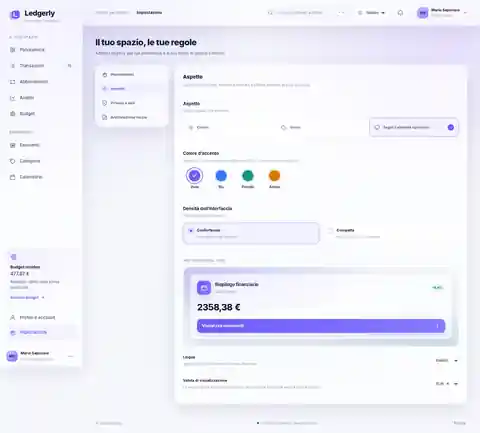
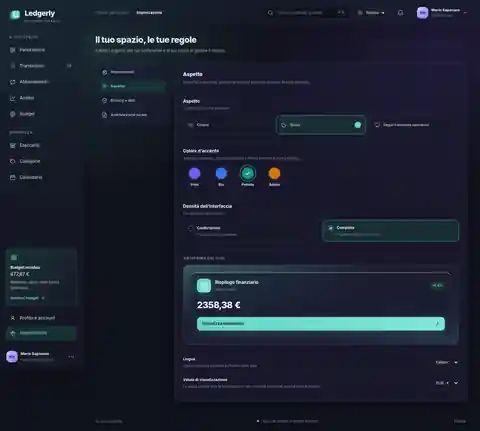

# Ledgerly

**Personal finance workspace · local-first by default · Italian / English / Spanish**

Ledgerly is a responsive personal finance tracker for transactions, subscriptions, budgets, merchants, categories and financial analytics. The repository contains the self-contained frontend, the optional Supabase Auth/cloud-sync adapter, PostgreSQL migrations, release checks and deployment configuration.

> **Release status:** Supabase is provisioned and the frontend public configuration is wired. Email/password Auth and per-user workspace sync are implemented in source but not yet end-to-end verified on a production URL. Google and Microsoft login still require provider credentials in Supabase Auth. No live Vercel deployment is verified yet.

## Current features

- Responsive fintech dashboard with light/dark appearance, accent palette and density settings.
- Transactions, categories, merchants, subscriptions, budgets, calendar and analytics.
- Italian, English and Spanish UI.
- Local-first mode with browser storage, CSV import/export and JSON backup.
- Supabase Auth adapter for email/password registration and sign-in, password recovery, Google OAuth, Microsoft/Azure OAuth, sign-out and per-user snapshot sync.
- PostgreSQL migrations for profiles, notification preferences, workspace snapshots, RLS policies, safe trigger execution and least-privilege table grants.
- Static release validation via GitHub Actions.

## Beta visual archive

Only compressed visual references from earlier beta iterations are kept in `beta/images/`. Historical beta source code and sample personal/financial data are not included.

| Appearance | Dashboard |
|---|---|
|  |  |
|  |  |

These are reference screenshots from earlier iterations, not evidence of production behavior.

## Run locally

Open `index.html` in a modern browser for local-first use. The Supabase project URL and **publishable** key are already configured in `config.js` for hosted use. They are intentionally browser-public values; Row-Level Security is mandatory. For a different Supabase project, change the two public config values, then apply all SQL migrations before enabling cloud functionality.

Never place service-role/secret keys, database passwords, OAuth client secrets, email provider API keys or VAPID private keys in frontend code or GitHub.

## Configure cloud authentication and sync

The Supabase project is provisioned at [Supabase Dashboard](https://supabase.com/dashboard/project/uqddabngitzbzqpmkquz). These migrations are applied to the live database and also versioned in this repository:

1. `supabase/migrations/001_profile_preferences_and_workspace.sql`
2. `supabase/migrations/002_restrict_profile_trigger_execution.sql`
3. `supabase/migrations/003_least_privilege_table_grants.sql`

Before relying on cloud features:

1. Set the final Vercel site URL and allowed redirect URLs in Supabase Auth.
2. Enable and test email confirmation, password recovery and sign-out; configure SMTP for reliable production delivery.
3. Create Google and Microsoft Entra OAuth clients and place their client credentials in Supabase Auth settings only.
4. Test cross-user RLS isolation, sync conflicts and local/remote merge with disposable accounts and backup data.

The snapshot adapter has revision conflict checks and an explicit merge prompt. It is an initial cloud foundation, not a substitute for normalized financial tables or full concurrency/recovery testing. Never silently overwrite cloud data with local state.

## Vercel deployment

A Vercel project named `ledgerly` is visible in the connected account, but its current API state reports no successful deployment or attached domain and the Vercel Git context does not yet report a linked repository. No production URL is verified. This must be resolved before calling Ledgerly published.

The workflow [`.github/workflows/deploy-vercel.yml`](.github/workflows/deploy-vercel.yml) is prepared but deliberately gated off until the repository owner configures the exact Vercel secrets and enables it.

In GitHub → Settings → Secrets and variables → Actions, configure repository secrets:

- `VERCEL_TOKEN`: token generated in your Vercel account.
- `VERCEL_ORG_ID`: exact Organization ID from Vercel project settings.
- `VERCEL_PROJECT_ID`: exact Project ID from Vercel project settings.

Then create the Actions variable `VERCEL_DEPLOY_ENABLED=true` only after confirming the Vercel project is correctly linked. The workflow deploys the committed static configuration and does not overwrite it with blank environment values. Keep the Vercel token in GitHub Secrets; never put it in a file or chat. See [`docs/DEPLOYMENT.md`](docs/DEPLOYMENT.md).

## Notifications

Browser notification permission is requested only after the user initiates the action. Remote push/email notifications are not active: they require a scheduler/worker, delivery provider, stored endpoint subscriptions/credentials, consent handling and real delivery tests.

## Quality and security

- Run static release validation with `node scripts/verify-release.mjs`.
- GitHub Actions quality checks run on pushes/pull requests to `main`.
- Review [`SECURITY.md`](SECURITY.md) before deploying.
- Do not use real bank credentials or highly sensitive financial documents in a public beta.
- Production readiness requires verified hosting, auth callbacks, password recovery, cross-user RLS tests, backup/restore, cloud export/deletion, concurrency conflict handling and notification delivery.

## License

MIT. See [`LICENSE`](LICENSE).
